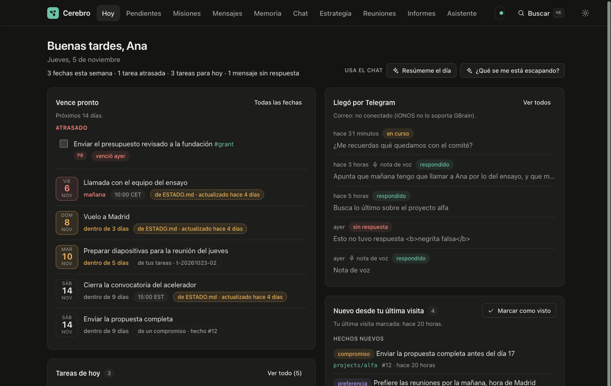
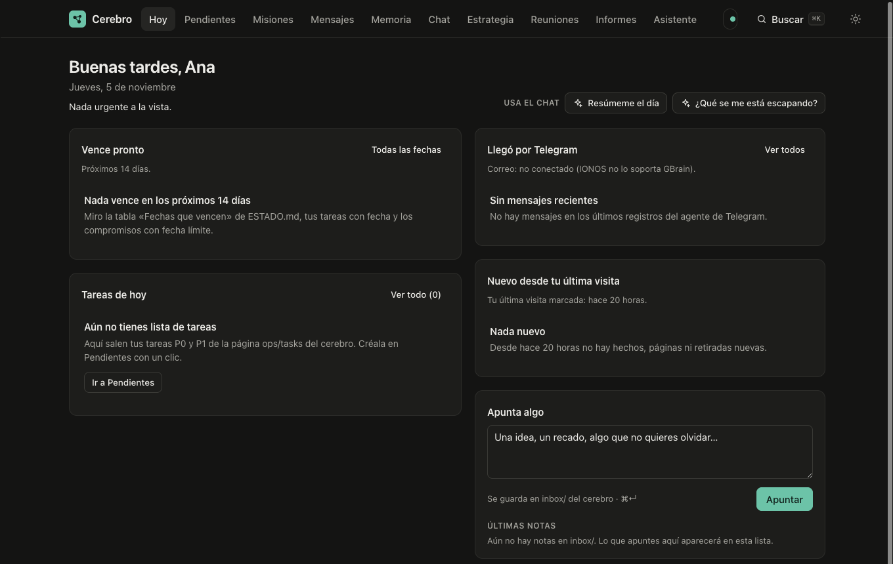
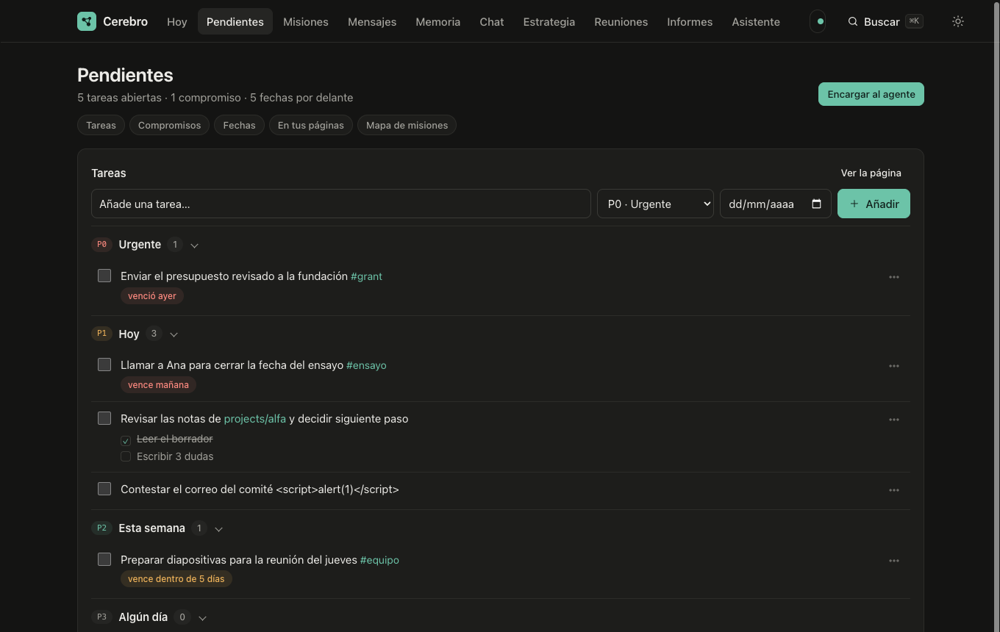
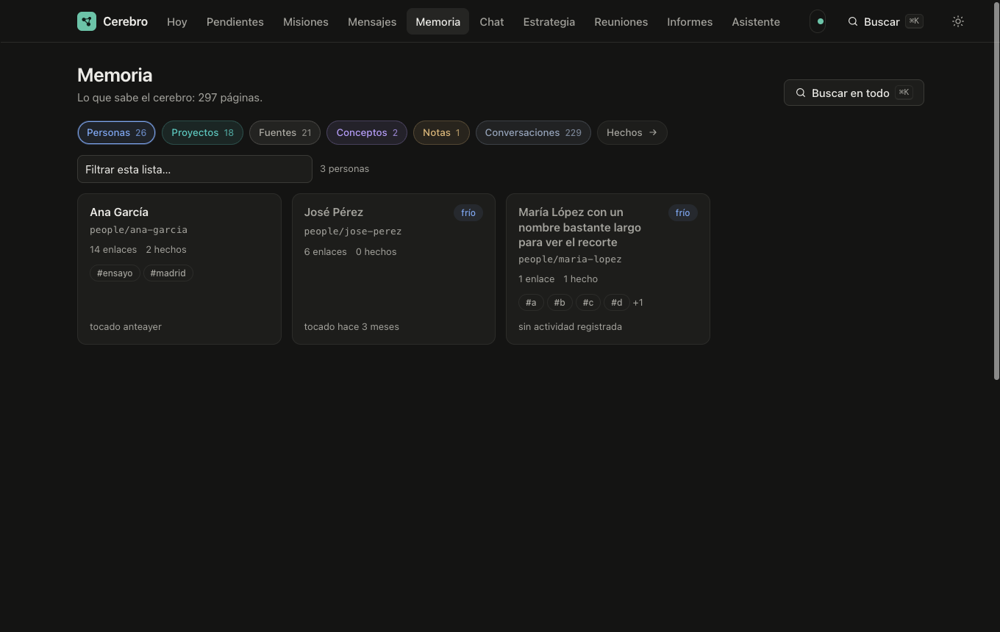
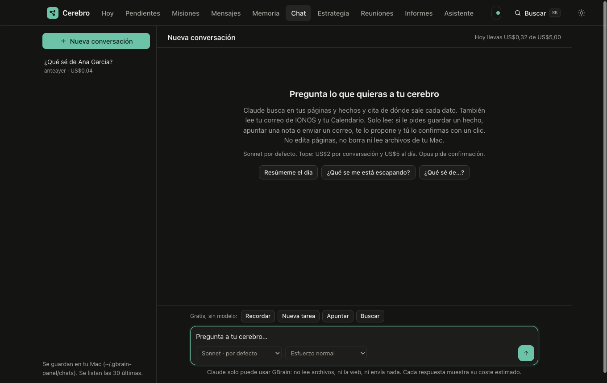
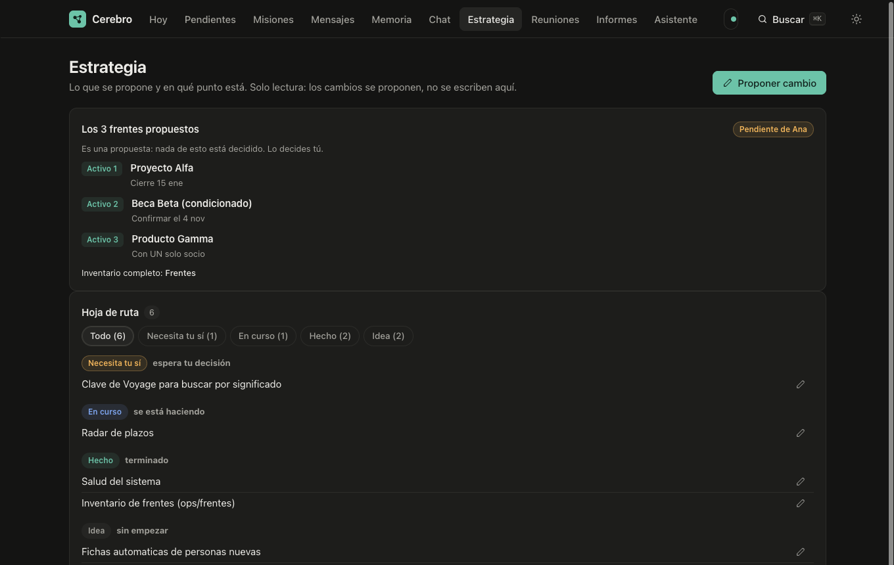
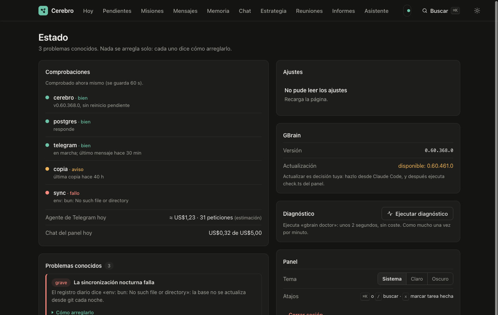

# GBrain-app: memoria personal + panel «Cerebro» (plantilla vacía)

Esta es la estructura completa de la app **sin ningún dato personal**: ni misiones, ni notas, ni correos, ni conversaciones, ni hechos. Todo lo que verás en la app lo generas tú con tus propios datos (por ejemplo, con el export de claude.ai).

Qué incluye:

- **Panel «Cerebro»** (`panel/`): una web local en `http://127.0.0.1:3140` (Hoy, Pendientes, Misiones, Mensajes, Memoria, Chat, Estrategia, Asistente, Informes, Reuniones, Estado). Solo escucha en tu Mac.
- **Scripts** (`ops/`): importar el export de claude.ai, copias de seguridad, tarea diaria, correo, audio, recordatorios, etc.
- **Agentes** (`agente-telegram/`, `agente-hermes/`): instrucciones para un agente de Telegram y para «Hermes» (empuja en todos tus frentes).
- **Cerebro vacío** (`brain-plantilla/`): carpetas y plantillas con las que `setup.sh` crea tu `brain/`.

> Está pensado para macOS (usa launchd, Llavero, Swift).

## Capturas

Son del servidor de pruebas del panel (`panel/test/mock-server.ts`), con datos **inventados**; tu copia empezará vacía.

| | |
|---|---|
|  **Hoy**: fechas, tareas y mensajes |  **Así empieza** tu copia, antes de importar nada |
|  **Pendientes** |  **Memoria** |
|  **Chat** con tu cerebro |  **Estrategia** |
|  **Estado** del sistema | |

## 1. Requisitos

| Requisito | Para qué | Obligatorio |
|---|---|---|
| macOS | todo | sí |
| [Bun](https://bun.sh) | servidor del panel | sí |
| GBrain (https://github.com/garrytan/gbrain) con Postgres local, base `gbrain` | el motor de memoria | sí |
| Claude Code (`claude`) con sesión iniciada | chat del panel y agentes | sí |
| `git`, `python3`, `zsh` | scripts | sí |
| `age` | copia cifrada a iCloud | no |
| Bot de Telegram | agente móvil | no |
| Buzón IMAP/SMTP | correo en el chat | no (ver nota en `ops/correo.py`) |

Instala GBrain siguiendo su documentación oficial. Notas de uso de la instalación original: base `gbrain` en Postgres 17, `GBRAIN_FTS_LANGUAGE=spanish` en `~/.gbrain/.env`, servidor MCP en `127.0.0.1:3131`. Revisa los comandos exactos en su repositorio, porque aquí no se han vuelto a comprobar.

## 2. Clonar y configurar

```bash
git clone <URL-de-este-repo> ~/GBRAIN
```

```bash
cd ~/GBRAIN && zsh setup.sh
```

`setup.sh` te pregunta nombre, correo y organización y:

1. Sustituye los marcadores `__HOME__`, `__REPO__`, `__USER__`, `__NOMBRE__`, `__EMAIL__`, `__ORG__`… en todos los archivos.
2. Renombra los `.plist` de launchd con tu usuario.
3. Crea `brain/` (copia de `brain-plantilla/`) como **repo git independiente** y vacío. `brain/` está en `.gitignore`: tus datos nunca se suben con este repo.

Se ejecuta una sola vez (deja `.setup-hecho`).

## 3. Arrancar el panel

Prueba a mano (se para con Ctrl-C):

```bash
bun run ~/GBRAIN/panel/server.ts
```

Para que arranque solo, instala el servicio (sustituye `<usuario>` por tu usuario de macOS):

```bash
cp ~/GBRAIN/panel/launchd/com.<usuario>.gbrain-panel.plist ~/Library/LaunchAgents/
```

```bash
launchctl bootstrap gui/$(id -u) ~/Library/LaunchAgents/com.<usuario>.gbrain-panel.plist
```

Ábrelo con doble clic en `panel/Abrir panel.command`. Comprobación de dependencias (solo lectura): `bun panel/check.ts`. Pruebas: `cd panel && bun test`.

Al principio todo aparece vacío: es lo esperado.

## 4. Rellenarlo con tus datos de claude.ai (export)

1. En claude.ai: **Ajustes → Privacidad → Exportar datos**.
2. Te llega un enlace por correo (caduca en 24 h). Descarga el zip.
3. Déjalo en `~/Downloads` sin meterlo en carpetas. Su nombre empieza por `data-`, `conversations-` o `memories-`.
4. Prueba sin importar nada:

```bash
zsh ~/GBRAIN/ops/export-claude-detectar.sh --dry-run
```

5. Importa de verdad:

```bash
zsh ~/GBRAIN/ops/export-claude-detectar.sh --run
```

   Solo lee `conversations.json`; no toca ni borra tu zip, ni importa datos de cuenta ni inicios de sesión. Lo ya importado se salta solo. Registro en `~/Backups/gbrain/export.log`.

6. **Alternativa: una página por conversación** (resumen de Claude + tus propios mensajes, sin las respuestas de Claude). Descomprime el zip en una carpeta tuya y ejecuta:

```bash
python3 -I ~/GBRAIN/ops/claudeai-conversations-to-pages.py <ruta>/conversations.json ~/GBRAIN/brain
```

```bash
cd / && gbrain sync
```

   Crea `brain/conversations/claude-ai/…`.

7. (Opcional) Vigilancia automática de Descargas: copia `ops/com.<usuario>.export-claude.plist` a `~/Library/LaunchAgents/` y cárgalo con `launchctl bootstrap`.
8. Recarga el panel: Memoria, Chat y Hoy ya tendrán contenido.

Las memorias del export (`memories*`) se extraen a la carpeta de trabajo pero no se importan; si las quieres, guárdalas como páginas en `brain/sources/claude-ai/`.

Cada mes puedes repetir el export; solo entra lo nuevo.

## 5. Opcionales

- **Tarea diaria** (`ops/gbrain-daily.sh`): ingiere sesiones de Claude Code, hace commit del cerebro, `gbrain sync` y copia de seguridad. Prográmala con un `.plist` de launchd (p. ej. 03:30).
- **Copia fuera del Mac**: añade un remoto `origin` privado a `brain/` y el script lo subirá. No lo hagas con el repo de la app para tus datos.
- **Fuentes propias**: copia `ops/fuentes-plantilla.sh` a `ops/fuentes/<nombre>.sh`, cambia `ORIGEN` y `NOMBRE`, y ejecútalo con `--dry-run`, `--stage` y `--publish`. Excluye secretos, duplicados y archivos grandes.
- **Telegram**: `zsh ops/set-telegram-token.sh` (pide el token con entrada oculta; nunca lo pegues en un chat) y `ops/telegram-agent.sh`.
- **Correo**: `ops/correo.py` e `ionos-imap.py` vienen con servidores IMAP/SMTP de IONOS; cambia `IMAP_HOST`/`SMTP_HOST` por los de tu proveedor. La clave se lee del Llavero (servicio `ionos-imap`), nunca va en archivos.
- **Clave de API** para el selector de facturación: Llavero, servicio `anthropic-api-key`, cuenta = tu usuario de macOS.

## 6. Estructura completa

```
GBRAIN/
├── README.md              este archivo
├── setup.sh               personaliza la plantilla (una vez)
├── .gitignore             excluye brain/, secretos y estado local
├── brain-plantilla/       cerebro vacío → setup.sh lo copia a brain/
│   ├── README.md, LICENSE, skillpack.json
│   ├── skills/            brain-router, memory-care, memory-recall
│   ├── concepts/ people/ projects/ reuniones/ wiki/
│   ├── conversations/claude-ai/      conversaciones importadas
│   ├── informes/<tema>/              informes de trabajo
│   ├── notes/ (+ coach/)             notas y bitácora del coach
│   ├── ops/tasks.md                  lista de tareas (P0–P3, Deferred, Completed)
│   ├── sources/ (+ informes-claude/DIARIO)   material importado
│   └── dream-cycle-summaries/
├── panel/                 panel «Cerebro» (Bun + web)
│   ├── server.ts, check.ts, config.json, README.md, SPEC.md, Abrir panel.command
│   ├── lib/               ajustes, artdb, asistente, auth, chat, config, correo, db, diario,
│   │                      estado, estrategia, gbrain, health, pending, pulse, render, sample,
│   │                      tasks, telegram
│   ├── public/            index.html, app.js, app.css
│   │   ├── views/         hoy, pendientes, misiones, mensajes, memoria, chat, estrategia,
│   │   │                  asistente, informes, reuniones, estado, hechos, pagina
│   │   ├── components/    chips, confirm, minigraph, palette, toast, toolchip, visibles
│   │   └── artifacts/     cola.html, mapa.html (misiones genéricas, vacías), claude-shim.js
│   ├── agente-chat/       instrucciones y MCP del chat (solo lectura)
│   ├── agente-asistente/  asistente de formularios (hooks y ajustes)
│   ├── app-mac/           app nativa de Mac (Cerebro.swift, build.sh)
│   ├── launchd/           servicio del panel
│   ├── vendor/            marked (Markdown)
│   └── test/              pruebas con datos inventados
├── ops/                   scripts
│   ├── export-claude-detectar.sh, claudeai-conversations-to-pages.py   export de claude.ai
│   ├── gbrain-daily.sh, gbrain-backup.sh, gbrain-offsite.sh            tarea diaria y copias
│   ├── gbrain-mcp-stdio.sh, gbrain-ingest-correo.py
│   ├── correo.py, correo-enviar.py, correo-mcp.py, ionos-imap.py, agenda.swift   correo y agenda
│   ├── telegram-agent.sh, telegram-enviar.py, set-telegram-token.sh   Telegram
│   ├── agente-rutina.sh, agente-recordatorios.sh, recordatorios.py, hermes-empuje.sh
│   ├── audio-a-cerebro.sh, audio-pagina.py, voz-a-texto.sh             audio local
│   ├── literatura.py, radar-web.py, chrome-dominios.py
│   ├── fuentes-plantilla.sh                                           copiar carpetas propias
│   ├── com.<usuario>.export-claude.plist
│   └── LEEME-export-claude.txt, LEEME-claude-desktop.txt
├── agente-telegram/       CLAUDE.md (modo coach), rutinas/*.md, .mcp.json, .claude/settings.json
└── agente-hermes/         empuje.md
```

## 7. Dónde viven tus datos (nada de esto va al repo)

| Qué | Dónde |
|---|---|
| Contenido en Markdown | `~/GBRAIN/brain/` (repo git propio) |
| Hechos y búsqueda | Postgres local, base `gbrain` |
| Estado del panel, sesiones, misiones y borradores | `~/.gbrain-panel/` |
| Copias de seguridad y registros | `~/Backups/gbrain/` |
| Ajustes de coach y recordatorios | `~/.gbrain-coach/` |

Las pestañas **Misiones** (cola de borradores y mapa) empiezan vacías: guardan en `~/.gbrain-panel/artdb/`.

## 8. Estado de las pruebas

`cd panel && bun test`: 190 pasan y 3 fallan (en `chat.test.ts`, el tope diario de gasto y el runner con `claude` falso). Esos 3 fallaban ya en el original antes de limpiarlo; no se han investigado.
